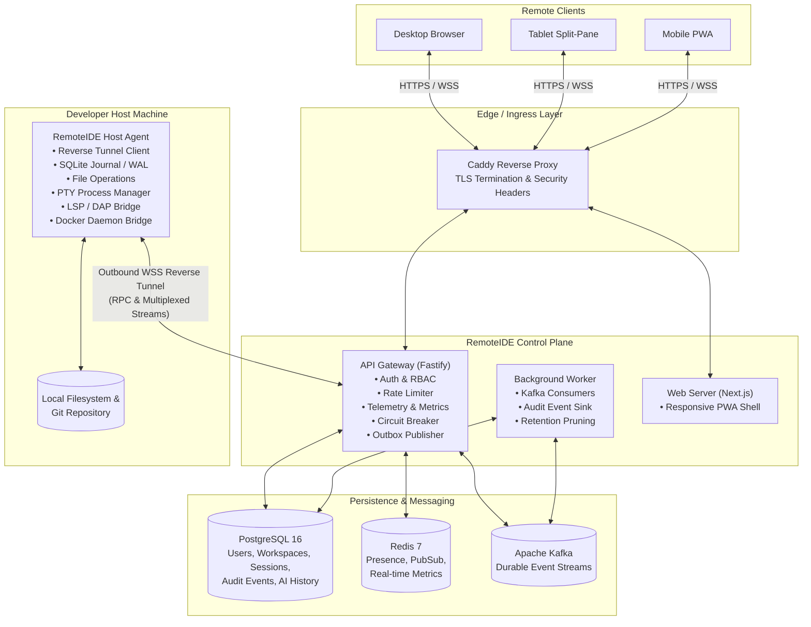
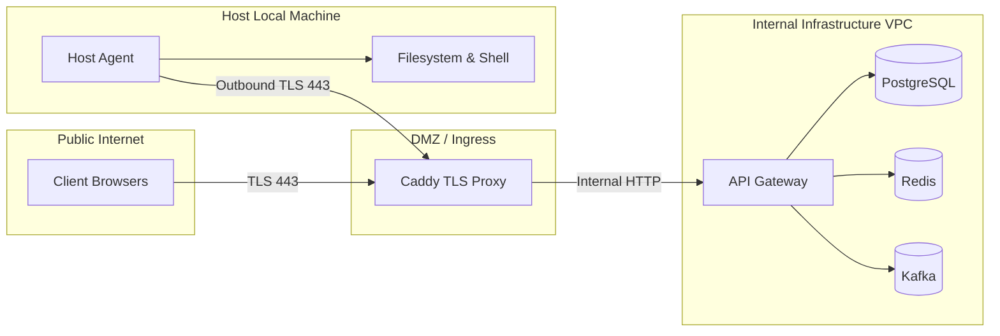

# RemoteIDE Architecture Specification

RemoteIDE is a distributed, multi-tenant remote development environment that bridges local developer workstations and remote clients (desktop browsers, tablets, and mobile PWAs) without requiring open inbound firewall ports on developer machines.

---

## 1. High-Level Architecture Diagram

---

## 2. Core Subsystems

### 2.1 Reverse Tunnel Infrastructure
- **Outbound Only**: The Host Agent initiates an outbound TLS WebSocket connection to `/ws/tunnel`. The host firewall requires zero open inbound ports.
- **Multiplexed RPC**: Requests from Gateway to Agent (file reads, executions, git commands, port forward requests) flow over JSON-RPC 2.0 frames over the tunnel.
- **Circuit Breaker**: The Gateway wraps tunnel RPC invocations in a stateful `CircuitBreaker`. If the host agent becomes unresponsive or disconnects, calls fail fast (`503 Service Unavailable`) rather than hanging client requests.

### 2.2 Real-Time Collaboration (Yjs & CodeMirror 6)
- **Authoritative Host Storage**: File contents are authoritative on the host agent filesystem.
- **CRDT Synchronization**: Collaborative sessions maintain a shared `Y.Doc` state synchronized via WebSockets (`/ws/collab`).
- **Permission Boundary**: Viewer (read-only) roles are cryptographically prevented from injecting document update frames.
- **Batched Host Writes**: Edits are flushed to the host disk in debounced, atomic writes to protect flash media and prevent IO starvation.

### 2.3 Event Sourcing & Catch-Up Reconciliation
- **Durable Outbox Pattern**: State mutations produce monotonic integer revisions committed locally to SQLite on the host and forwarded to PostgreSQL / Kafka.
- **Disconnection Reconciliation**: When mobile devices disconnect (e.g. going through a subway or network transition), the gateway tracks their cursor revision. Upon reconnecting, `/api/v1/catchup/summary` provides a net-diff changelog without transmitting the full repository.

### 2.4 Strictly Read-Only AI Assistant
- **Google Gemini SDK Integration**: Communicates with `@google/genai` using streaming token generation.
- **Zero-Mutation Guarantee**: The AI assistant can explain code, suggest diffs, and diagnose error traces, but has zero tools to mutate the local filesystem or execute terminal commands directly.
- **Encrypted Storage**: Gemini API keys are encrypted at rest using AES-256-GCM before storage in the database.

---

## 3. Network & Security Boundaries

1. **Internal Datastores Unexposed**: PostgreSQL (`5432`), Redis (`6379`), and Kafka (`9092`) listen strictly on private container networks and are never exposed to the public internet.
2. **SSRF Guard**: Gateway and Agent outgoing HTTP requests validate destination IP addresses against RFC 1918, RFC 3927 (link-local/cloud metadata), and infrastructure ports.
3. **Path Traversal Guards**: Every file system access resolves symlinks (`realpath`) and asserts containment within the authorized workspace root.
