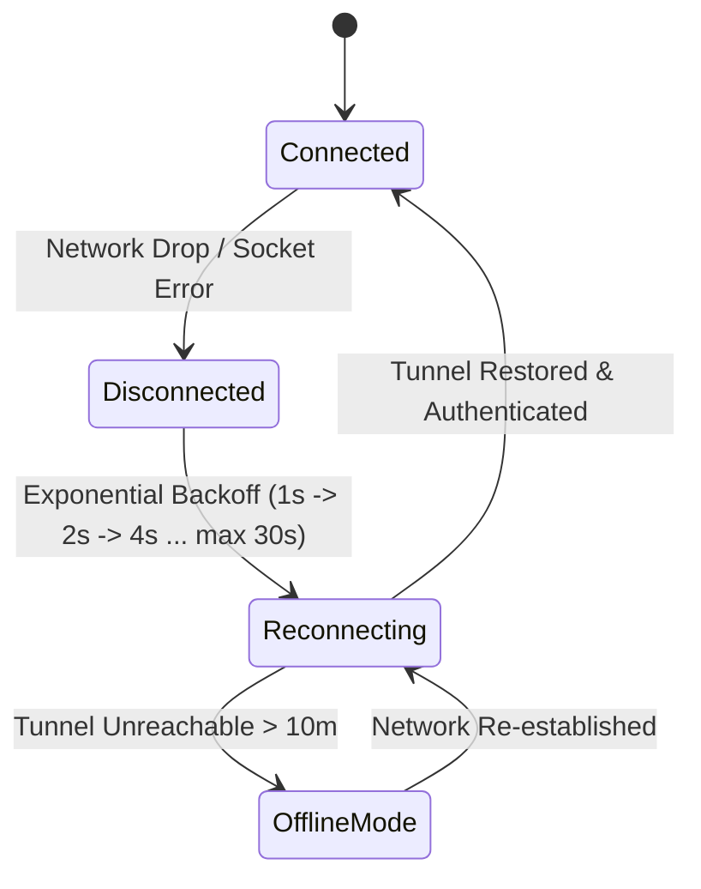

# RemoteIDE Host Recovery & Crash Consistency Guide

This guide describes how the RemoteIDE Host Agent recovers from abrupt crashes, kernel panics, network partitions, and power failures without losing developer code or corrupting workspace state.

---

## 1. Durability & Crash Guarantees

The RemoteIDE Host Agent adheres to the following durability guarantees:
1. **Local Filesystem Primacy**: The workstation filesystem is the single source of truth. RemoteIDE never discards uncommitted local files in favor of remote state without explicit developer confirmation.
2. **Atomic Writes**: All file modifications dispatched over the tunnel write to a temporary file (`.filename.tmp.uuid`) on the same filesystem before performing an atomic rename (`fs.renameSync`). This eliminates partial-write corruption.
3. **SQLite Write-Ahead Logging (WAL)**: The local metadata journal uses `PRAGMA synchronous = NORMAL` and WAL mode, guaranteeing journal transactions survive process termination.

---

## 2. Reconnection & Backoff Architecture

When a network partition occurs between the Host Agent and the Gateway:



### Backoff Parameters
- **Initial Delay**: 1,000 ms
- **Backoff Factor**: 1.5x
- **Max Delay**: 30,000 ms
- **Jitter**: ±20% randomized jitter to prevent thundering herd against the Gateway.

---

## 3. Journal Replay & Catch-Up Workflow

Upon restoring the reverse tunnel connection:

```
Agent                                      Gateway
  │                                           │
  ├─── 1. Authenticate & Report Last Rev ────>│
  │    `tunnel.handshake { lastRev: 142 }`    │
  │                                           │
  │<── 2. Gateway Catchup Summary ────────────┤
  │    `{ missedRevisions: 0, actions: [] }`  │
  │                                           │
  ├─── 3. Flush Local Outbox Journal ────────>│
  │    Replay uncommitted offline events      │
  │                                           │
  │<── 4. Acknowledge Batch ──────────────────┤
  │    `{ ackRevision: 145 }`                 │
```

1. **Vector Clock & Revision Check**: The agent presents its highest locally committed revision.
2. **Conflict Detection**: If files were modified externally (e.g. by another local editor or `git pull`) while the tunnel was disconnected, the agent detects the timestamp and hash divergence.
3. **Controlled Merge**: Rather than overwriting collaborative drafts, a non-destructive conflict notification is surfaced to active client editors.

---

## 4. Recovering from an Agent Crash

If the agent daemon terminates unexpectedly:

```bash
# 1. Inspect recent crash logs
remoteide-agent logs -n 100

# 2. Verify local database integrity
sqlite3 ~/.remoteide/state.sqlite "PRAGMA integrity_check;"

# 3. Restart the daemon
remoteide-agent restart

# 4. Verify tunnel health
remoteide-agent health
```
The agent re-reads the SQLite journal, restores active PTY terminal process associations if alive, and resumes reverse tunnel operation seamlessly.
