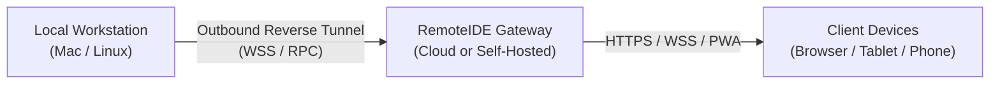

# RemoteIDE Quickstart Guide

Get up and running with RemoteIDE in under 5 minutes. By the end of this guide, you will connect your local development environment to RemoteIDE and edit, run, and collaborate on your project from any browser or mobile device.

---

## 1. Five-Minute Overview



---

## 2. Step 1: Start the Gateway & Web Interface

If you are running the self-hosted stack locally:

```bash
# Clone and enter the repository
cd RemoteIDE

# Start supporting services (PostgreSQL, Redis, Kafka) or use dev mode
pnpm install
pnpm dev
```

The gateway listens on `http://localhost:3001` and the web interface opens on `http://localhost:3000`.

---

## 3. Step 2: Generate an Agent Connection Token

Open your browser to `http://localhost:3000` or use the CLI bootstrap:

1. Obtain your initial bootstrap setup token from gateway logs:
   ```bash
   # In terminal output:
   # RemoteIDE Setup Token: setup_sec_...
   ```
2. Log in and create an agent host token under **Settings > Connected Hosts > Add Host**.
3. Copy the generated host authorization token (`agt_sec_...`).

---

## 4. Step 3: Connect Your Host Agent

On the computer where your source code lives:

```bash
# Run the host agent pointing to your workspace directory
remoteide-agent \
  --gateway ws://localhost:3001/ws/tunnel \
  --token agt_sec_your_token_here \
  --workspace ~/my-project
```

Output:
```
[INFO] RemoteIDE Agent starting...
[INFO] Establishing reverse tunnel to ws://localhost:3001/ws/tunnel...
[INFO] Reverse tunnel established successfully. Host ID: host-my-workstation
[INFO] Workspace root registered: ~/my-project
```

---

## 5. Step 4: Open and Edit in Your Browser

1. Navigate to `http://localhost:3000`.
2. Select your newly connected workspace **"my-project"**.
3. You will see:
   - **File Explorer**: Browse files directly on your local workstation.
   - **Editor**: CodeMirror 6 with full syntax highlighting and auto-save.
   - **Terminal**: Embedded xterm.js connected directly to your local bash/zsh shell.
   - **Git Panel**: Visual staging, commits, branches, and diffs.

---

## 6. Step 5: Test Cross-Device Continuity & Mobile PWA

1. On your smartphone or tablet, navigate to `http://<your-lan-ip>:3000` or your public URL.
2. Log in or scan the QR code from the desktop menu (**"Continue on Another Device"**).
3. Tap **"Install App"** / **"Add to Home Screen"** to launch full-screen PWA mode.
4. Changes made on desktop appear in real time on mobile through Yjs collaborative CRDTs.

---

## 7. Next Steps

- [System Architecture](file:///Users/aman/Documents/Project/RemoteIDE/docs/architecture.md)
- [REST API Reference](file:///Users/aman/Documents/Project/RemoteIDE/docs/api.md)
- [Security Hardening & Threat Model](file:///Users/aman/Documents/Project/RemoteIDE/docs/security.md)
